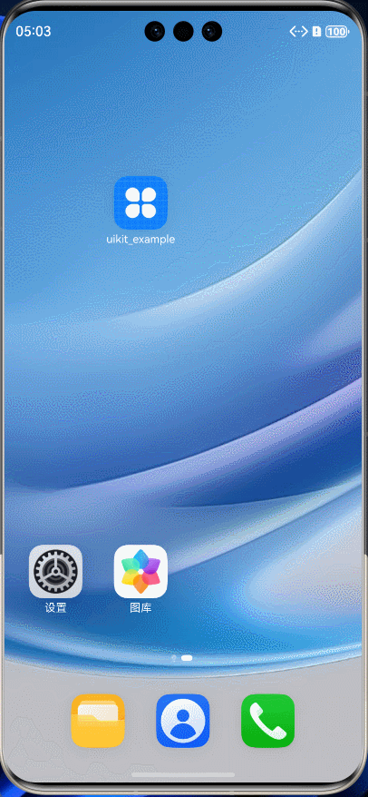

# uikit

[](https://pub.dev/packages/uikit_plus)
[](https://github.com/zhengzaihong/uikit)
[](LICENSE)


Language: English | [简体中文](README-ZH.md)


A fully **Dart-based** cross-platform **Flutter UI component library**, supporting compilation to **HarmonyOS (SDK ≥ 3.29)**. It provides high-quality, extensible UI components to make your project development more efficient!

---

## 🌐 Live Demo

Open the interactive component gallery: **[zhengzaihong.github.io/uikit](https://zhengzaihong.github.io/uikit/)**

---

## 🌟 Highlights
- 📦 Rich UI components: input fields, pickers, tables, menus, animation effects, etc.
- 🔗 **Zero dependencies**, fully implemented in Dart, ready to use out of the box.
- 🎨 Highly customizable, supporting style extensions and secondary encapsulation.
- 🌍 Multi-platform support: **Android / iOS / Web / Windows / MacOS / Linux / HarmonyOS**
- 🔥 Continuously updated, already providing **30+ commonly used components**

---

## 📦 Installation
Add dependency in `pubspec.yaml`:
```yaml
dependencies:
  uikit_plus: ^0.4.4
```

```dart
import 'package:uikit_plus/uikit_lib.dart';
```

> The old version is not maintained; the last release of the old package is `flutter_uikit_forzzh: 0.3.1`.


## 📚 Component Catalog

## Input & Form Components
- **InputText**: Minimal input field with real-time validation, supports all TextField/TextFormField properties
- **InputValidation**: 10+ built-in validators (email, phone, URL, ID card, number, etc.) with combination validation
- **InputExtend**: Search component with all TextField properties
- **KitCheckBox**: Checkbox with tri-state support, haptic feedback, and custom icons
- **KitSwitch**: Switch component supporting Android/iOS styles with haptic feedback
- **ImageSwitch**: Highly customizable switch button

## Progress & Rating
- **LinearProgressBar**: Linear progress bar with customizable colors and animations
- **CycleProgressBar**: Circular progress bar with gradient support
- **RatingBar**: Rating component with value formatter and custom star styles
- **TimeView**: Countdown timer with pause/resume, progress tracking, and auto-restart

## Pickers & Selectors
- **CityPickerView**: City picker with province/city/district selection
- **DatePicker**: Date picker with multiple modes
- **SelectionMenu**: Dropdown menu with smart positioning
- **SelectionMenuForm**: Dropdown with real-time validation
- **InfiniteLevelsMenus**: Infinite-level menus with simplified logic
- **MultiSelector**: Infinite-level collapsible menu with multi-select

## Display Components
- **Toast**: Fully customizable toast (style, position, queue support)
- **ZTooltip**: Tooltip for any widget with custom content
- **Shimmer**: Shimmer loading effect
- **MarqueeView**: Marquee component with pause/resume control
- **Bubble**: Bubble component with multiple arrow styles
- **GlobalDialog**: Global dialog with auto-dismiss and singleton management

## Layout & Navigation
- **TableView**: Table layout with horizontal and vertical scrolling
- **Pager**: Pagination with theme system (4 built-in themes)
- **CustomAnimatedBottomBar**: Bottom navigation with badge support and haptic feedback
- **StackCard**: Stacked card component with swipe gestures
- **FloatExpendButton**: Expandable menu button (up/down/left/right)
- **DrawerRouterStack**: Multi-level drawer navigation
- **SmartDrawer**: Flexible drawer with custom width

## Animation & Effects
- **SplashBobbleAnimation**: Splash bubble animation with custom colors and curves
- **TextExtend**: Text with web-style effects and elastic animations

## Charts
- **Radar5DimensionsChart**: 5-dimensional radar chart
- **RadarChart**: N-dimensional radar chart

  ...continuously updating....


### Special note: Support compilation to HarmonyOS

